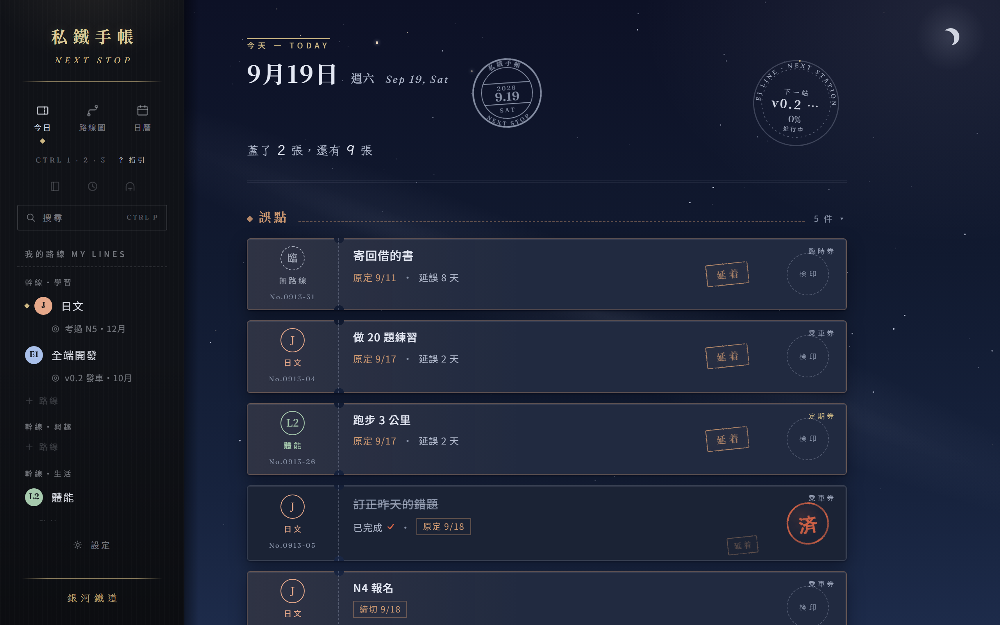
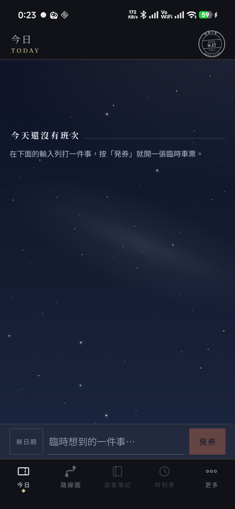

# 🚉 私鐵手帳 · 私鉄手帳 · Next Stop

> 把人生當成一條自己的私鐵來經營的個人生產力 App。
> A personal productivity app that runs your life like a private railway — tasks as tickets, goals as routes, milestones as stations. Local-first, end-to-end-encrypted sync, Windows + Android.

[](https://github.com/TipsyDrifter/next-stop/releases/latest)  

<p align="center">
  <br>
  
</p>

---

## 這是什麼

我想把散在 Notion、flomo、時間日誌、記帳 App 裡的人生紀錄收回同一個地方，而且要「順手到不費力、用久了看得到累積」。所以做了這個。

任務管理、旅客筆記（靈感＋日記）、時刻表（時間記錄）、售票口（記帳）、同步與備份五個模組都已出貨，我已經正式拿它取代原本那幾個 App。桌機和手機同一版一起出、功能一樣完整（唯一的例外是〈外部助理〉只在桌機）。

### 現在能做什麼

**🚉 路線圖與任務**

- **鐵道語彙的任務樹**：幹線（領域）→ 路線（目標）→ 列車（階段）→ 車票（待辦），里程碑是路線上的車站。層級不寫死，怎麼掛都行；列車可以整串「移動到…」別條路線。
- **今日**：今天要跑的班次一列排開，蓋一枚朱印「済」就完成；誤點、推遲、運休、途中下車各有標記。車票可以寫「幾點」，今日就照時刻排、頁首寫下一班。蓋完一班列車會跳完成卡，選個心情、記一句這一趟做了什麼。
- **定期券**：重複的事由規則排班；可以只改某一班的時刻，或只讓那一班運休。
- **行程表**：月、週、時段（一週 × 24 小時）、串流（從今天往上下捲）四種看法，任何一天都能建票、蓋章、推遲。把執行日改到今天以前＝補記「那天就做完了」。
- **找東西**：`Ctrl+P` 快速跳轉（車票、路線、`#荷札`、`$帳目`、筆記與日記都找得到）；`Ctrl+Shift+F` 完整搜尋，連概要和乘務記錄都搜、不限筆數。
- **手機一樣能改**：路線圖每一列都有「⋯」，車票詳情整頁可編輯，幹線、路線、車站都能在手機上管理；今日的車票長按拖曳換順序。

**📝 旅客筆記**（靈感與日記）

- **隨手記一句**：桌機 `Ctrl+N`；App 不在前面時按 `Ctrl+Alt+N` 叫出一張小捕捉票，記完焦點還給原本的程式。手機用浮動鈕，或在別的 App 選「分享」→「私鐵手帳」。記下的話可以直接變待辦、筆記、日記、一筆帳，或先放進收件匣之後再整理。
- **筆記**：可以掛在路線、列車上（從路線那一側也看得到掛在上面的筆記）；讀的時候有 Markdown 排版。
- **日記**：以天為單位，沒寫的日子可以補記。旁邊自動排出那天的足跡：蓋了章的車票、工作日誌、心情，還有那天的時間花在哪（時間塊的色帶與各分類合計）。
- **荷札**（標籤）：打 `#名稱` 就掛上，可以用 `/` 分層、改名、合併。車票、筆記、日記、時間塊都能掛，從任何一張牌都找得回來。

**⏱ 時刻表**（時間記錄）

- **計時**：發車台點一個分類就開始，點另一個就換車，一天的時間在軸上一塊塊接起來；沒記到的空白事後補，時間可以直接打 `0830`、`2330`。
- **接上任務**：在車票上按「発車」，時間就記在那張票上；任務側板看得到整棵樹各花了多少時間。
- **六種看法**：發車台、軸、週、統計（日／週／月，和上一期的同一段比；可依分類、荷札、路線看）、日程（左邊排定的、右邊實際的，看準不準點）、方眼（一天鋪成格子，拖過一段就補記）。
- **時數目標**：例如「這週創作至少 10 小時」「娛樂每週至多 20 小時」，達成會蓋章。
- **App 沒開也看得到**：桌機在系統匣（右鍵可以直接到着、換車），手機在通知欄（常用分類一格一格，點一下就換車）；跑太久會提醒。

**💴 售票口**（記帳）

- **記一筆**：收入、支出、轉帳；捕捉框打 `80 午餐 @現金` 一行就記好。多帳戶、多幣別、兩層分類，常用的排在前面。
- **看帳**：清單、月曆、統計（分類占比、12 個月走勢、依帳戶或路線看）；跨月搜尋與篩選，可以依金額排序。路線側板寫著這條路線本月花了多少。
- **管帳**：每月總預算與分類預算（超支一眼看得出來）；定期帳每天／每週／每月自動記一筆，忘了開 App 的日子會補上。
- 可以從財務管家的備份（`.mmbak`）匯入舊帳。

**☁️ 同步與備份**

- **雲端同步**：桌機 ↔ 手機雙向、端對端加密。兩台改到同一格時後改的贏，輸的那筆寫進乘務記錄、不會不見；同步卡在要你處理的狀態時，主畫面出一條橫幅外加一則通知。怎麼開見下面〈雲端同步怎麼開〉。
- **本機備份**：每天第一次開 App 自動拍一份快照（在資料庫升級之前拍），也可以手動備份、設第二個備份位置；到設定〈備份與還原〉就能還原。
- **雲端備份**：每天自動上傳一份加密快照，階梯式保留一年；任何一台都能還原到任何一份。
- **復原碼**：忘了密語、又要讓新裝置加入時的最後一條路。**重新開始**：只清這台，或所有裝置一起清空。

**其他**

- **外部助理**（桌機）：設定〈外部助理〉打開後，Claude 這類 AI 助理可以透過本機接口讀寫手帳。任務、時刻表、筆記、日記、帳目各自決定「關／只看／可改」，預設全關；助理一次要排好幾件事時，會先給你看方案、你同意才寫入。
- **兩套主題**：粉彩星空／銀河鐵道，也可以跟著系統的深色模式走。
- **每個功能都有看得到的按鈕**；快捷鍵是加速用的，完整的表在設定〈快捷鍵〉，按 `?` 叫出指引。

## 安裝

到 [Releases](https://github.com/TipsyDrifter/next-stop/releases/latest) 下載：

| 平台 | 檔案 | 備註 |
|---|---|---|
| Windows x64 | `NextStop_<版本>_x64-setup.exe` | NSIS 安裝檔。未簽章，SmartScreen 會擋一次：其他資訊 › 仍要執行。資料在 `%APPDATA%\app.shitetsu.nextstop\`。 |
| Android arm64 | `NextStop_<版本>_arm64.apk` | 側載安裝；同簽章可直接覆蓋升級。第一次掃配對碼時會要相機權限。 |

只用桌機也完全可以，同步是選配。

## 雲端同步怎麼開（自用階段的做法）

同步後端目前是 **Cloudflare R2**（S3 相容物件儲存，免費層綽綽有餘），需要你自己的帳號與 bucket。專案附一支精靈帶你走完：

```bash
bash scripts/setup-r2.sh
```

它會開瀏覽器帶你開通 R2、建 bucket、建一把只限該 bucket 的 API token，最後用 curl 實際列一次 bucket 驗證，把值寫到 `%LOCALAPPDATA%\NextStop\r2.env`（repo 外）。

然後在**任何一台**打開〔設定 › 同步〕（手機是〔更多 › 同步〕）按「加入同步」：填四欄＋一句密語（≥ 8 字）。桌機可按「從精靈匯入」自動填；手機掃另一台畫面上的配對碼，或把它貼進來。任何一台都可以是第一台，先加入的那台說了算。

要記的規則只有三條：

| | 規則 | 會發生什麼 |
|---|---|---|
| ① | **加入** | 雲端是空的 → 這台成為第一台；雲端有資料而這台是空的 → 直接拉下來；**兩邊都有資料 → 問你一次**：「兩邊都保留」（同一張票以較晚改的為準，被蓋掉的值寫進該票的乘務記錄）或「改用另一台的」（這台現有的先留一份：桌機自動備份、手機拍一份到雲端，再換掉）。 |
| ② | **還原** | 從備份還原時問一次（桌機的本機備份、或任一台的雲端備份，同一套問法）：「回到過去」＝所有裝置都改用這份（備份之後的修改會消失，其他裝置還沒送出的修改另存成檔、**不會自動併回**）；「接上現在」＝只有這台換成備份，其他裝置比備份新的修改會再蓋回來（**刪除也算修改**——已經同步出去的誤刪找不回來）。還沒加入同步的機器不問，還原只動這一台；之後加入同步時若兩邊都有資料會問你要不要合併——所以**舊電腦壞了、只剩備份**時的正確順序是「先還原、再加入同步，加入時選『兩邊都保留』」。 |
| ③ | **重新加入** | 「重新加入同步」＝把這台拿掉再放回去，回到①重問一次。清掉的是這台的同步設定、憑證與身分，資料與雲端上的東西都不動。 |

只是**換了一把 R2 token**（或把外流的舊 token 撤銷了）不必走③：到〔設定 › 同步〕按「更新憑證…」重填四欄＋現在的密語就好，資料、身分與紀元都不動。每一台各自更新一次。

**密語可以改，忘了也改得了。** 資料是用一把隨機的資料鑰匙加密的，密語只負責把那把鑰匙包起來放在雲端，所以改密語**預設**＝重包那一顆鑰匙物件：**資料不重傳、其他已加入的裝置不受影響**（之後新加入的裝置要用新密語）。已加入的裝置手上本來就有資料鑰匙，所以〈密語〉頁的「現在的密語」**可以留白**——忘記密語不必重配任何東西，直接設一個新的即可。兩台同時改＝後送上去的那次生效。

**要真的換鎖，就勾「同時換掉資料鑰匙」。** 只重包鑰匙擋得住「拿到密語的人再加一台」，擋不住「已經抄走舊密語與桶內物件的人」——他手上那份副本照樣打得開。改密語表單上那一格勾下去就是換鎖：產一把新的資料鑰匙、用新密語重包、把雲端上的快照全部重新加密、刪掉舊鑰匙加密的所有東西，**舊密語從此開不了任何一份**。代價寫在勾選旁邊：其他裝置會停在「鍵違い」，各自用新密語「重新加入同步」即可（加入時選「兩邊都保留」，它們還沒送出的修改會一起併進來）——所以換鎖之前先讓每一台都同步完。換到一半關掉 App 也沒關係，下次打開會自己接著做完；要是某一台一直說「另一台正在換鑰匙」超過一天，就是那台沒做完，去那台開一次 App 就好。勾了才需要打「現在的密語」（那是作廢舊密語，得先證明你手上有它）；真忘了就走規則③「重新加入同步」。

**雲端備份。** 同步之外還有一份可以往回翻的：

- 每天第一次同步成功後，自動把整份資料加密上傳成一份快照（也可以隨時按「立即備份到雲端」多拍一份）。與同步的變更日誌一樣，上傳前就加密完了，伺服器只存密文。
- 保留是階梯式的：最近 14 天每份都留，之後每週留一份（到 3 個月）、每月留一份（到 1 年），其餘自動清掉。
- **任何一台都能還原到任何一份**，手機也可以。問的還是規則②那個二選一（「回到過去」／「接上現在」，後果一字不差）；還原前會先把這台現在的資料留一份（桌機存成保險備份、手機先拍一份到雲端），然後重新啟動。

桌機在〔設定 › 備份與還原〕的「雲端」區；手機在〔更多 › 備份與還原〕的「雲端」區（〔更多 › 同步〕的「雲端備份」區看到的是同一份清單）。手機的本機備份也在〔更多 › 備份與還原〕：自動備份、立即備份、備份清單與「還原到這份」都和桌機一樣；桌機獨有的「第二備份位置／開啟備份資料夾」，手機改用「另存一份…」替代（把備份存到下載或雲端硬碟，換手機時在新手機按「從檔案還原…」接回）。同步頁另有一顆「匯出到手機」，把整份資料存成一個 JSON 檔（只能人工翻閱，App 不能匯入）。

**重新開始（清空資料）。** 桌機在〔設定 › 備份與還原〕最底的「危險區」，手機在〔更多〕頁最底。「只清這台」會先拿掉這台的同步設定、再清掉所有車票、班次、乘務記錄與筆記（主題等設定留著），其他裝置與雲端都不動，之後再「加入同步」就會把雲端那份拉回來；「所有裝置一起重新開始」則讓雲端換上一份空的，其他裝置下次同步會被問要不要「一起清空」（同步身分與密語都保留，還沒加入同步的機器只能清自己）。清之前有三層保護：先留一份底（兩台都會先在這台存一份本機備份，備份清單裡看得到；已加入同步的還會上傳一份雲端保險快照）、要親手打「清空」兩個字才按得下去、確認窗把後果講白。後悔要趁早：雲端那份保險快照兩週內一定救得回，本機那份會隨每天的自動備份輪替掉。

**同步出狀況時 App 會提醒。** 同步停在要你處理的狀態時——改正待ち（另一台換上了一份新的資料，等你按「改用那份」）、鍵違い（另一台換過鑰匙，或雲端上有這台打不開的東西）、停車中（連續三趟、約三分鐘以上沒同步成功；手機顯示沒網路的那段不算，網路一斷就叫太吵）、信号待ち（兩台的版本不一致，要先更新較舊的那一台）——主畫面頂端會出一條橫幅（手機在頁首下方）。按「前往同步」直接到同步頁看出路；「先收起」只收這一次，狀態還沒解除的話下次打開 App 會再出現，解除了就自己消失。同一個狀態只會多送**一則**系統通知（每次打開 App 最多一則，不會每分鐘響）；換鑰匙完成、還原完成也各送一則。Android 13 以上會在第一次加入同步成功後問一次通知權限（從舊版升級、早已加入的手機則是升級後第一次打開時問），不給也沒關係，橫幅照常出現。**手機 App 沒在前景時不會同步、也就不會有通知**——打開 App 會立刻補跑一趟，有狀況就出橫幅＋通知。自己把同步總開關關掉不算出狀況，不會提醒。已知限制：桌機點通知不會把 App 叫到前面；開發版的通知會顯示成 PowerShell 的名字（安裝版正常）。

**復原碼：忘了密語時的最後一條路。** 在〔同步〕的「復原碼」區按「產生復原碼」，會拿到一組 27 個字的碼（五個字一組、用連字號隔開），**只顯示這一次**，這台也不會留存——抄在紙上或密碼管理器裡，和密語分開放。之後任何一台**還沒加入同步的**裝置，在「加入同步」按「忘記密語？用復原碼」，填四欄＋這組碼（大小寫與連字號都不必管）就能加入、拿回資料；加入後 App 會請你到〈密語〉設一個新密語（現密語留白），其他裝置之後用新密語加入。已經加入的裝置忘了密語不需要它（留白改密語就好）。按「重新產生」＝舊碼立刻作廢。換鑰匙若在**產生這組碼的那一台**做，碼照樣有效；在別台換鑰匙，舊碼會作廢，App 會提醒你重新產生一組。任何人只要同時拿到這組碼和你的 R2 bucket，就能讀你的資料——請當成密語一樣保管。不確定以前有沒有產過：這一區標著「已設定」就是有。

變更日誌以 XChaCha20-Poly1305 加密後才上傳，伺服器只存密文；R2 的 token 與這台的裝置身分存在系統鑰匙圈（Windows Credential Manager）／App 私有目錄，**不放在資料庫裡**——所以備份還原不會換掉裝置身分，而把整個資料夾複製到另一台就是「新的一台」，走①合併進來。忘記密語不會弄丟任何東西：已加入的裝置照常同步（它們用的是資料鑰匙），到〈密語〉頁留白現密語直接設一個新的，就能再加新裝置。真的走投無路（所有裝置都沒了、只剩備份與桶）時先找復原碼（見上）；連復原碼也沒有，才需要人工重來一次：到 Cloudflare 後台刪掉 `<root>/SALT`、`<root>/KEY`、`<root>/RECOVERY`、`<root>/snapshots/` 與所有紀元目錄，再從有資料的那台「加入同步」當第一台，其餘裝置會變成「鍵違い」，各自「重新加入同步」選「兩邊都保留」即可。

**端對端加密的代價：有一種情況誰也救不回。** 雲端上只有密文，打得開它的鑰匙只在你的裝置、密語和復原碼裡。所以**所有裝置都沒了、密語和復原碼也都找不到**時，雲端那份資料任何人都解不開——包括你自己、Cloudflare 和任何工程師。趁裝置還在，到〔同步〕的「復原碼」區產一組抄好，和密語分開放。另一條不靠密語的退路是本機備份檔：它們沒有加密，第二備份位置若設在雲端硬碟的同步資料夾，裝置全滅時那裡的檔案還在——裝好 App 後到設定〈備份與還原〉按「從檔案還原…」挑那一份。

> 要求使用者自建 R2 顯然不適合對外的正式版；換成普及帳號同步或代管服務是之後要重談的題目。

## 出狀況時

**動手救之前，先留一份底。** 桌機的資料全在 `%APPDATA%\app.shitetsu.nextstop\`（資料庫是 `next-stop-v2.db`，備份在裡面的 `backups\`）。先從系統匣右鍵「結束」把 App 真的關掉，再把整個資料夾複製到別處，之後怎麼試都有退路。手機的資料在 App 自己的私有空間，**別用「解除安裝再重裝」來修**——解除安裝會把手機上的資料一起清掉，只剩同步和雲端備份拿得回來。

### App 開不了，或打開後說資料庫不能開

- **桌機點了沒反應**：多半它已經開著、縮在系統匣（工作列右下角的小圖示，可能收在 ^ 裡）。按 ✕ 只會縮到系統匣；再點一次捷徑、或系統匣右鍵「開啟 Next Stop」，就會叫出原本的視窗。
- **打開了，畫面只有一行 ⚠ 說資料庫先不開**：這是 App 在保護資料——它發現資料庫跟這一版對不上，所以一筆都不碰。那句話裡會寫下一步：
  - 寫著「請安裝最新版再開」（被較新版用過）：這台裝的是舊版。到 [Releases](https://github.com/TipsyDrifter/next-stop/releases/latest) 裝最新版（兩台最好一起升）。
  - 寫著「結束……再打開一次」：桌機從系統匣右鍵「結束」、手機從最近使用的 App 把它滑掉，再打開一次。
  - 寫著「請回報這個狀況」：資料庫沒有被改過，但問題出在安裝的這一版、不在你的資料，App 裡修不了——直接看下面「該停手」。
- **更新後閃退、白畫面**：用同一版的安裝檔再裝一次。覆蓋安裝不會動資料；解除安裝的畫面若問要不要刪除應用程式資料，別勾。

**該停手、改問工程師或 AI 助理的時候**：⚠ 那行寫著「請回報」，或重裝同一版還是打不開。這時別刪資料夾、別拿備份檔去蓋 `next-stop-v2.db`，把三樣東西交出去：那行訊息的原文、App 版本、上面複製出來的資料夾。不用擔心升級弄壞資料——每天第一次開 App，在資料庫升級之前就會先拍一份快照到 `backups\`。

### 同步壞了

- **有橫幅**：橫幅會寫是哪一種狀況（改正待ち、鍵違い、停車中、信号待ち），按「前往同步」到同步頁照著做。每種狀況的意思與出路，寫在上面〈雲端同步怎麼開〉的「同步出狀況時 App 會提醒」那段。
- **沒有橫幅、只是覺得沒同步**：到同步頁按「立即同步」，看它說什麼。手機只有 App 在前景時才同步。
- **跟鑰匙有關的**：忘了密語＝〈密語〉頁「現在的密語」留白、直接設新的；R2 token 換了或外流＝「更新憑證…」；某一台一直停在鍵違い＝那一台「重新加入同步」、加入時選「兩邊都保留」。

**該停手的時候**：同步頁的錯誤訊息一直不變、上面查不到它的意思，或你正打算照「走投無路」那段去 Cloudflare 後台刪東西——先停。刪雲端物件收不回來；把同步頁的訊息原文交給工程師或 AI 助理，確認過再動。

### 兩台的資料對不上

1. 兩台都打開 App、各按一次「立即同步」（手機要停在前景）。很多時候只是其中一台還沒送出。
2. 看兩台的版本一不一樣：手機在〔更多〕頁看得到版本號，桌機看 Windows〔設定 › 應用程式 › 已安裝的應用程式〕裡的「私鐵手帳」。版本不同時同步會停在「信号待ち」，先把舊的那台更新。
3. 還是不對：先決定哪一台是對的，在**錯的那一台**按「重新加入同步」（要再填一次四欄＋密語：桌機可按「從精靈匯入」，手機可掃另一台的配對碼），加入時選「改用另一台的」——這台現在的資料會先留一份（桌機自動備份、手機拍一份到雲端），再換成另一台的。兩邊各有對的部分，就選「兩邊都保留」。
4. 兩台都不對（例如誤刪的東西已經同步出去了）：到設定〈備份與還原〉，從雲端備份還原到出事前的那一份，選「回到過去」（規則②）。

**該停手的時候**：做完 3 或 4 還是不對，或你說不準哪一台才是對的。「改用另一台的」和「回到過去」都會把一邊蓋掉，不確定時先別按；把兩台各自哪幾筆不一樣記下來，交給工程師或 AI 助理。

## 從原始碼建置

需要 Node 22+、pnpm 10+、Rust 1.95+；Android 另需 JDK 17、Android SDK（platform 36、build-tools 35）、NDK 28.2.13676358。換一台新電腦從零裝起的指令，見 [docs/發版流程.md](docs/發版流程.md)〈換新電腦重建環境〉。

```bash
pnpm install
pnpm tauri:dev                  # 桌機開發（vite 1425 + cargo；用 dev 專用的 identifier，不會碰到已安裝的正式版資料）
pnpm tauri build --bundles nsis # 桌機安裝檔
source scripts/android-env.sh && pnpm tauri android build --apk --target aarch64   # Android APK
```

Android 專案（`src-tauri/gen/android`）已經在 repo 裡、而且改過，直接 build 就好；`tauri android init` 會把改過的檔案重生成模板。

瀏覽器只看畫面：`pnpm dev` 後開 `http://localhost:1425/?mock=1`（假資料，不碰 SQLite）。

發版一行：`bash scripts/release.sh <版號> --notes docs/release-notes/v<版號>.md`。

## 技術

Tauri 2 · React 19 · TypeScript · Vite 7 · Tailwind 4 · Zustand · SQLite（tauri-plugin-sql / sqlx）· 同步引擎 Rust（object_store → R2、HLC 欄位級 LWW、argon2id + XChaCha20-Poly1305）。

```
src/            React 前端（ui/ 依頁面分：today、outline、calendar、settings、mobile…；data/ repository 層；store/ zustand）
src-tauri/      Rust：lib.rs 掛 plugin；backup.rs 備份三件套；sync/ 同步引擎；migrations/ SQL
scripts/        setup-r2.sh（R2 精靈）、release.sh（發版）、mirror-publish.sh（發到公開鏡像）
docs/           發版流程、release-notes、截圖
```

> 這個公開 repo 是私有開發 repo 的鏡像：只含程式碼、安裝包與說明文件，沒有開發歷史；每做完一個功能就整包推一次。

## 路線圖

| 版本 | 內容 | 發布 |
|---|---|---|
| v1.0 | 桌機任務管理：任務樹、今日、定期券、日曆、本機備份、主題 | 2026-09-15 |
| v1.1.x | Android 手機版＋雲端同步（端對端加密、雙向、衝突處理、還原）、雲端備份、同步告警與復原碼 | 2026-09-18～09-29 |
| v1.2–v1.4 | 旅客筆記（捕捉、收件匣、筆記、日記與足跡）、時刻表（計時、發車台、軸、系統匣） | 2026-10-10～10-12 |
| v1.5–v1.14 | 售票口（帳本、看帳、預算與定期帳）、行程表與車票時刻、荷札、筆記掛樹與 Markdown、捕捉小窗、時刻表通知操作與任務連動 | 2026-10-14～10-19 |
| v1.15–v1.17 | 時刻表統計與目標、日程、方眼、荷札接軌；手機殼與全 App 文案的磨光、試用回饋 | 2026-10-19～10-22 |
| v1.18 | 介面統一：按鈕、浮層、頁首、選單換成同一套 | 2026-10-23～10-24 |
| v1.19 | 日記足跡接上時間塊、完整搜尋 | 2026-10-26 |
| v1.20 | 手機能直接改路線圖與車票、外部助理（MCP） | 2026-10-26 |
| v1.21 | 同步引擎：兩台同時改同一筆的情況一次補完 | 2026-10-27 |
| 之後 | 維護與小改進；統計儀表板、主題商店這類加分項之後再排 | — |

每一版改了什麼，看 [docs/release-notes/](docs/release-notes/) 或 [Releases](https://github.com/TipsyDrifter/next-stop/releases)。版號照做完的順序發，不綁功能；每一版桌機和手機一起出。

想法與回饋歡迎開 issue 丟進來。

## 關於

這是我和我的 AI 搭檔小紗一起做的專案：我當設計師與 PM，她當工程師。

MIT License。

> 「願這條軌道一直延伸到你想去的所有地方」♡
